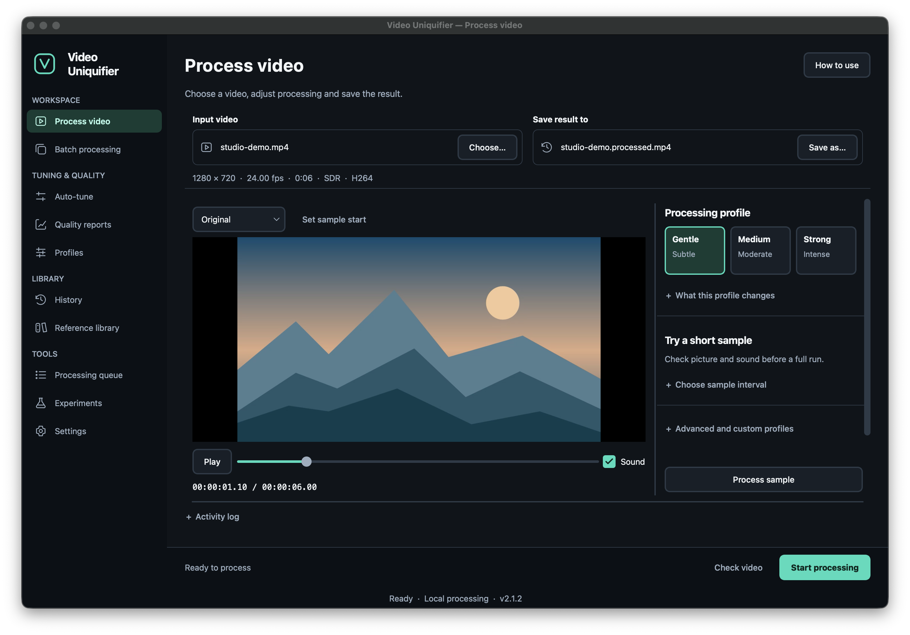

# video-uniquifier

[English](README.md) · [Русский](README.ru.md) · [简体中文](README.zh-CN.md)

为自有或已获授权的视频进行处理与重新编码。先预览变换，再对比原片与成片，
通过桌面应用、命令行或本地网页界面处理单个视频或批量任务。

**源码版本：2.2.0** ·
[下载](https://github.com/Hostlife22/video-uniquifier/releases) ·
[文档](https://hostlife22.github.io/video-uniquifier/zh/) ·
[版本记录](CHANGELOG.md)

**视频交付 / Reels：** 桌面端 **工作区 → 视频交付** 和 `video-reels` Worker 提供交付编码、
两遍响度归一化、质量报告、镜头时间线及可选的人工标题和 Logo。
[使用指南](docs/zh/facebook-reels.md)介绍四步桌面操作、CLI、HTTP 与 NestJS/BullMQ 对接。
无需 AI 或云端模型，不包含发布功能。



## 功能

### 桌面工作区与对比

- 大尺寸视频播放器支持播放、定位、声音控制，以及原片/成片切换。
  处理前可查看分辨率、帧率、时长、编码格式与 HDR 状态。
- 视频与预览、处理设置、进度与结果分为独立页面。
  轻度、中度、强度配置卡说明各自对画面和声音的影响。
- 先处理 10、15 或 20 秒 SDR 样片，再决定是否处理完整视频。
  可通过缩略图时间线、时间码或当前播放位置选择起点，并另存样片 MP4。
- 原片与成片同步对比：并排、单独显示，或在同一 SDR 画面中拖动分隔线。
  支持逐帧查看、选择试听音轨、同步缩放/平移及原像素大小检查。
- 按时间同步，或在恒定变速后按时长映射。HDR 使用原生视频面板，
  不提供 SDR 样片流程与栅格分隔线。
- 分阶段进度、已用时间及有测量依据时的剩余时间估计；
  跨页面的全局任务提示保留后台任务入口。
- 可调面板尺寸与表格布局，设置在会话间保存；支持深色/浅色主题、
  英语/俄语/简体中文、键盘导航与减少动画。
  每页的 **使用方法** 或 **F1** 打开当前页面说明。

详见[桌面界面参考](docs/zh/gui.md)。

### 画面、声音与配置文件

- 裁切/缩放、小角度旋转、镜像，以及裁切、黑边或模糊背景的比例适配。
  自定义画布默认避免放大源视频分辨率。
- 亮度、对比度、伽马、饱和度、噪声与轻度锐化，每项参数均经过校验。
  支持混合另一段自有/授权视频、烧录字幕；生成 SRT 需要单独安装 whisper.cpp 和模型。
- 变速同时调整音频节奏。实验性时间戳黑场/丢帧效果不属于质量优先默认设置。
- 音高/节奏调整、可选 Rubber Band、参数均衡器、重采样、压缩、混响、
  频谱调制与白/粉/棕噪声。立体声拓宽需检查相位与单声道兼容性。
- 两遍 EBU R128 响度归一化在音频链最后执行。
  可选择第一条、全部或指定音轨；音频效果作用于第一条选中音轨，
  其余音轨根据容器和时间要求保留或转码。
- 提供轻度、中度、实验性强度、HDR、横屏、竖屏、方形与 AV1 等 YAML 配置。
  支持 H.264、HEVC、AV1，以及 MP4、MOV、MKV 容器。
- 桌面配置编辑器可启用效果、编辑 JSON 参数、检查 YAML 并保存；
  无效参数禁止保存，覆盖现有配置前创建备份。
- 四种随机种子策略；恢复任务时保留已选参数，`--new-variant` 为支持的策略生成新变体。
- 社区配置安装校验 HTTPS、SHA-256 与结构，可额外要求 Ed25519 签名。

[配置文件](docs/zh/profiles.md) · [变换参考](docs/zh/transform_reference.md) ·
[随机种子策略](docs/zh/seed_strategy.md) · [社区配置库](docs/zh/marketplace.md)

### 编码、恢复与质量检查

- 真实试编码检测软件编码器及 NVIDIA NVENC、Intel QSV、AMD AMF、Apple VideoToolbox。
  可用性取决于设备、驱动、编码格式和 FFmpeg 构建。
  自动选择默认优先质量，也提供平衡/速度策略；显式选择不可用编码器时明确报错。
- 在支持的 10 位 HEVC 流程中保留 PQ/HLG HDR，或显式转换为 SDR。
  目前完整静态 HDR 元数据验证限于 `libx265`。
- 根据容器保留兼容字幕、音轨元数据和章节；支持的变速会同步调整 SRT 与章节时间。
- 预检在长时间编码前校验配置、编码器能力、流/容器映射、HDR 与音视频时间要求。
- 在关键帧边界切分视频，以受限并发处理片段并拼接；崩溃后按片段恢复。
  可选 PySceneDetect 镜头分段会对齐关键帧。
- 同机进程通过共享资源注册表协调编码槽位与临时磁盘预算；
  CPU/RAM 硬限制仍由操作系统或容器设置。
- 发布结果前检查流、时间戳、色彩契约，并完整解码主视频和全部音轨；
  即使关闭可选 QA 报告，这项正确性检查仍执行。
- HTML/JSON 报告区分媒体正确性、感知质量与诊断相似度，明确标注缺失测量值。
  支持 pHash、SSIM、可选 VMAF/SSCD，以及安装 `fpcalc` 后的 Chromaprint。
- 已有处理计划时，注册指标以预期变换的无损重放为参考，区分编码损失与主动变换。
  参考生成需要临时空间；保留 HDR 时不提供 registered VMAF。
- 可选全音轨 LUFS/真峰值扫描、VMAF/SSIM 门禁，以及兼容配置中的有限 VMAF 重试。
  本地 SQLite 参考库保存授权视频的指纹并支持比对。
- 实验性自动调参检查开头、中间、结尾样片，复用测量缓存；
  若质量与相似度约束无法同时满足，会明确标记未收敛。

[质量报告](docs/zh/qa_report.md) · [SSCD](docs/zh/sscd.md) ·
[参考库](docs/zh/corpus.md) · [自动调参](docs/zh/calibrate.md) ·
[硬件验证](docs/zh/hardware_qualification.md)

局部相似度指标不能预测外部版权管理系统的决定。指标不能替代样片与完整成片的人工观看和试听。

### 批处理、队列与集成

- 文件夹/所选文件批处理，逐文件状态与失败策略；历史、批处理和队列表格支持搜索、
  筛选、排序、调整列、选择可见行，以及打开视频、目录和报告。
- 共享文件系统分布式队列：原子租约、心跳、失效任务恢复与隔离的结果发布。
  实际部署必须验证文件系统所需的原子操作；此队列不依赖 Redis 或外部数据库。
- `video-uniq` 提供探测、预检、处理、QA、批处理、调参、参考库、队列、配置与字幕命令，
  各命令通过 `--help` 查看参数。
- 可选 FastAPI 网页界面适合本地服务器或 NAS，支持进度、取消和 HTML/JSON 报告。
  Docker/Compose 提供 FFmpeg、持久化媒体/工作目录及资源限制；网页流程比桌面功能更精简。
- Python 变换插件支持能力校验、允许列表与禁用控制，无需修改核心。
- Discord、Slack、Telegram、通用 webhook 或 SMTP 通知；
  本地遥测默认关闭，仅保存在设备上，可导出和删除。

[分布式批处理](docs/zh/distributed.md) · [网页与 Docker](docs/zh/web.md) ·
[插件](docs/zh/plugins.md) · [遥测](docs/zh/telemetry.md)

## 安装

从 [GitHub Releases](https://github.com/Hostlife22/video-uniquifier/releases) 下载发布包，
桌面包包含 Python 与 GUI 依赖。

| 平台 | 安装包 | FFmpeg |
| --- | --- | --- |
| Linux x86_64 | AppImage | 已包含 |
| macOS Apple Silicon | 应用 ZIP | 另外安装 |
| Windows | 可执行文件 ZIP | 另外安装 |

校验和、首次启动及 Intel Mac 安装见[安装文档](docs/zh/install.md)。
源码安装需要 Python 3.11+，并确保 `ffmpeg` / `ffprobe` 位于 PATH：

```bash
git clone https://github.com/Hostlife22/video-uniquifier.git
cd video-uniquifier
make dev PYTHON=python3
make gui
```

## 第一个视频

1. 打开 **视频处理**，选择输入文件和输出位置。
2. 先选择轻度配置并处理样片，用 **原片 / 成片对比** 检查画面、声音与同步。
3. 开始完整处理，完成后检查视频及质量报告。

SDR 样片默认 15 秒，可选择 10、15 或 20 秒。

```bash
.venv/bin/video-uniq run input.mp4 \
  --profile src/video_uniquifier/profiles/soft.yaml \
  --out output.mp4
```

任务还会生成 `output.mp4.qa.html` 与 `output.mp4.qa.json`。HTML 可在浏览器中打开。
使用 `make cli` 查看命令。

| 桌面选项 | YAML | 用途 |
| --- | --- | --- |
| 轻度 | `soft.yaml` | 首次质量检查的起点 |
| 中度 | `medium.yaml` | 更明显的处理 |
| 强度 | `aggressive.yaml` | 实验性处理，需要仔细验收 |

## 仓库结构

| 目录 | 用途 |
|---|---|
| `src/video_uniquifier/` | 应用代码及软件包资源 |
| `src/video_uniquifier/profiles/` | 随包提供的原生 YAML 配置，包括 Reels 基础配置 |
| `examples/facebook_reels/` | 业务规则、包装参数示例及外部 `bullmq/` 对接代码 |
| `docs/en/`, `docs/ru/`, `docs/zh/` | 英语、俄语和简体中文文档 |
| `tests/`, `tools/`, `pyinstaller/` | 测试、开发工具及桌面打包配置 |

## 文档与开发

[完整文档站点](https://hostlife22.github.io/video-uniquifier/zh/)提供三种语言，页眉可切换。
[API 契约](docs/zh/api-contracts.md)说明 Python 集成与兼容性。
安全问题请按[安全政策](SECURITY.md)报告。

```bash
make check        # lint, strict type checking, and tests
make test-unit    # fast unit tests
make build        # desktop bundle
make build-wheel  # Python wheel
```

开发流程见 [CONTRIBUTING.md](CONTRIBUTING.md)，全部命令见 `make help`。
文档开发：`pip install -e '.[docs]'`，再运行 `make docs-build` 或 `make docs-serve`。

## 许可证

MIT，详见 [LICENSE](LICENSE)。
