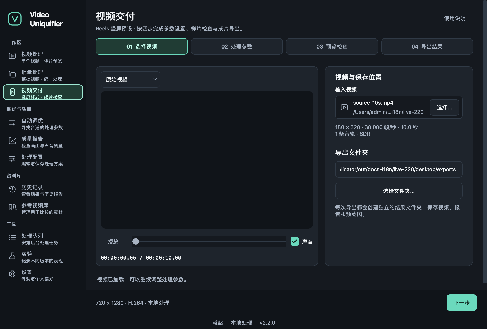
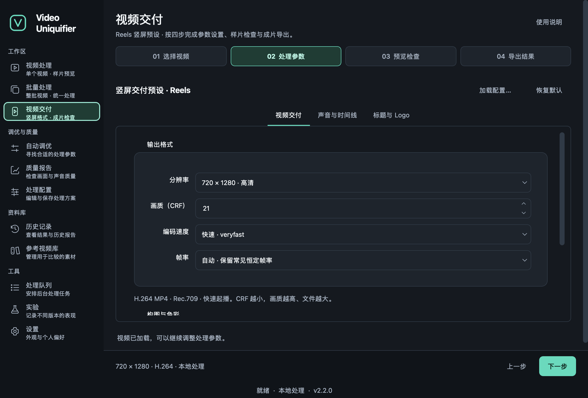
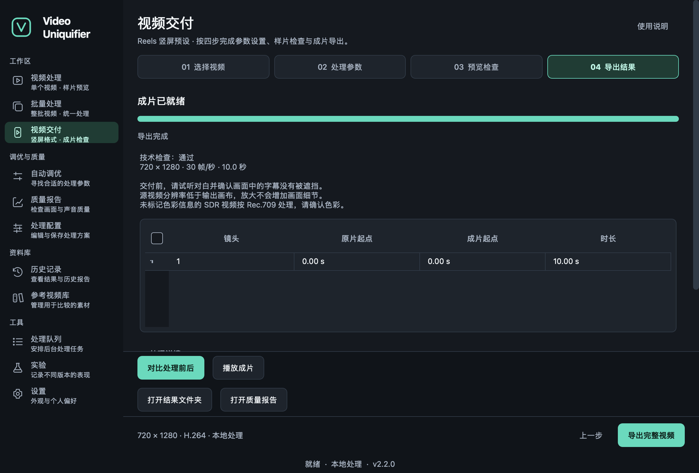

# Facebook Reels video delivery (experimental worker)

Process edited videos that you own or are licensed to distribute. The worker produces an MP4 for human review, a quality report, a scene timeline and previews. The P0/P1 implementation needs no AI, models or cloud service and does not publish videos. Version 2.2.0 uses an adapter validated against the original 2.1.2 engine API at commit
`e9138ddbc798cb23e28b44d9edf7959a712f0add`. The MIT license continues to apply. See the [implementation log](facebook-reels-development.md) for inspected APIs and evidence.

## Installation and CLI

Requirements: Python 3.11+, FFmpeg/FFprobe, libx264, loudnorm and colorspace. Explicit HDR conversion also requires zscale/tonemap. Default scene detection needs
`[scene]`; the HTTP service needs `[web]`.

```sh
sh tools/install_reels.sh
.venv/bin/video-reels validate examples/facebook_reels/reels_business_rules.yaml
.venv/bin/video-reels preflight input.mp4 --rules examples/facebook_reels/reels_business_rules.yaml
.venv/bin/video-reels run input.mp4 \
  --rules examples/facebook_reels/reels_business_rules.yaml \
  --asset-root ./assets --root ./reels-jobs --json-events
```

`run` accepts `--job-id`: letters, digits, underscores and hyphens, at most 64 characters. An existing job ID is never overwritten. Ctrl+C or SIGTERM uses the native CancelToken to terminate FFmpeg/scene-detection children and clean the working directory. Cancellation exits with 130; configuration/processing failure exits with 2. Failure details are JSON on stderr.

Desktop, CLI and API use the same processing core. The stable `video-uniq` CLI remains compatible. This preset currently uses the probed software libx264 encoder; hardware encoders are outside its delivery contract.

## Desktop: Workspace → Video delivery

```sh
uv pip install --python .venv/bin/python -e '.[gui,scene]'
.venv/bin/video-uniq-gui --reels
```

Video delivery prepares an already edited, authorized video using a Reels 9:16 preset. Open it under Workspace or press `Ctrl+Shift+R`. Its four steps are directly selectable:

1. **Choose video:** select or drop a source, inspect its resolution, frame rate, duration and audio tracks, and select an export directory.
2. **Processing settings:** adjust Video delivery, Audio and timeline, and Title and logo. Loading business YAML preserves advanced fields without dedicated controls. Titles and logos are off by default and require local assets when enabled.
3. **Preview and review:** validate the configuration, then generate up to ten seconds from the beginning of the selected interval. Check dialogue, subtitles and safe areas. Changing the source or settings invalidates the old sample. Full export still uses the complete selected interval.
4. **Export result:** start full export and follow progress, quality checks, warnings and the scene timeline. An export completed on the visible page opens the in-app before/after comparison: synchronized playback, shared seeking, frame stepping, original/result audio selection and a draggable comparison divider. Trimming aligns the original to the exported interval. Later form changes do not replace the completed comparison's sources. Reopen it with Compare before/after. Play result opens the in-app standalone player and also works if the original moved. Open quality report shows source/output resolution, frame rate, duration, bitrate, size and audio measurements in tables. Checks and warnings lists technical checks and items requiring human review. Missing measurements are explicit, never zero or an assumed pass. Raw JSON remains available for programmatic use. Background completion leaves the current page undisturbed; return to the result page to open review. Successful full exports enter the history.

Processing runs in a background thread. The global activity banner returns to the job. Cancellation terminates the core and child processes; closing waits for safe thread shutdown. Full exports are stored in `results/<job-id>/` under the chosen folder. Samples use temporary storage and are removed on exit. Failed QA does not publish a completed video.

`[gui]` does not include scene detection. Install `[scene]` or disable scene detection in Audio and timeline; missing dependencies produce actionable guidance. The current PyInstaller configuration also excludes the optional scene stack. Ordinary video processing has separate Source and preview, Processing settings, and Progress and result pages; sample actions are on Processing settings.

  

## Two configuration layers

| File | Purpose | Loader |
|---|---|---|
| `src/video_uniquifier/profiles/facebook_reels_base.yaml` | Native Profile with engine-supported fields | Native `video-uniq --profile`; optional worker `--profile` |
| `examples/facebook_reels/reels_business_rules.yaml` | Encoding, packaging, scenes, QA and resource rules | **Only `video-reels --rules`** |

The worker validates the native Profile and every transform's parameter schema, then derives fit_aspect, loudnorm and explicit tonemap settings from business rules. Stable Profile/Plan/RunOptions schemas are unchanged. Omitted business fields use strict defaults. Unknown fields, duplicate YAML keys, aliases, dangerous paths, excessive values, NaN/Infinity and numbers supplied as strings are rejected.

```sh
.venv/bin/video-reels schema > /tmp/reels-business.schema.json
```

FFprobe inspects the actual uploaded media; an allowed extension does not replace media validation. Defaults limit input to 2048 MiB, 7200 seconds and 8,847,360 pixels, with at most two concurrent CPU jobs. These are local budgets, not Facebook limits.
`worker.wall_timeout_sec` bounds scanning, encoding and preview subprocesses; probing, loudness measurement and QA also retain engine-specific timeouts. Encoding threads are allocated automatically, up to eight per job.

## Defaults and limitations

- MP4 with faststart, 1080×1920 or optional 720×1280, H.264 yuv420p, SAR 1:1, SDR Rec.709, CRF 21 and veryfast. Common CFR rates 23.976/24/25/29.97/30/50/59.94/60 are preserved; VFR is converted to 30 CFR.
- A 9:16 source keeps its complete frame. Other aspect ratios use native `pad_blur`. Center cropping requires both `geometry.nonvertical_source: crop` and
  `allow_center_crop: true`.
- HDR/PQ/HLG is refused by default. Set `video.hdr_policy: tonemap_sdr` explicitly to invoke native conversion. Wide-gamut sources without a reliable transfer function and SDR BT.2020 constant-luminance sources require prior verification or conversion. Unmarked ordinary SDR is interpreted as Rec.709 with a report warning; reliably tagged SDR receives a color conversion.
- Only the default audio stream is selected, or the first when none is default; its absolute stream index is recorded. Dialogue pitch and speed stay unchanged. Two-pass loudness targets are -16 LUFS, -1.5 dBTP and LRA 11; audio is AAC-LC, 48 kHz stereo, 128 kbps. Measurements are cached by input SHA256, selected audio, trim, targets, engine and FFmpeg version. Sources without audio remain video-only. Silence is recorded as `silent`; unstable measurements on very short audio are reported honestly. `audio.enabled: false` or `audio.loudnorm.enabled: false` disables normalization while retaining and consistently encoding the audio track.
- Native PySceneDetect integration writes `scenes.json`; it does not reorder or delete scenes or add transitions. `trim_start_sec/trim_end_sec` trim video and audio together; the timeline records source and output coordinates. Black frames and silence are diagnostic only. VFR scene positions need human review. Install `[scene]` or explicitly set `scenes.detect_enabled: false`. Trimming a source with separate soft subtitles is refused. Burned-in subtitles remain in the picture; complex soft-subtitle conversion/trimming is outside scope.
- Human-provided titles and PNG logos are disabled by default. Fonts must be existing, licensed assets below asset-root. Pillow renders transparent layers which join the native filter chain in **one video encode**. File hashes record reproducibility, not quality or platform originality.
- `examples/facebook_reels/packaging.json` shows packaging parameters; provide the referenced fonts/images. CLI uses the business YAML `packaging` node; the API accepts a multipart `packaging` JSON field. Paths must be relative to asset-root; traversal and escaping symlinks are refused. Text never enters a shell or FFmpeg expression. `title.start_sec/end_sec` refer to the **trimmed output**. Excess lines are not silently truncated. Out-of-bounds artwork or overlap with the protected subtitle area fails; title/logo overlap produces a warning. Adjust pixel-based margins and font size for a 720-wide canvas.
- Safe areas use internal heuristic margins: 6% left/right, 14% top, 30% bottom. There is no OCR to identify every burned-in subtitle. `safe-area.png` is a separate preview; it changes neither the cover nor the delivered video. `preview.mp4` stream-copies the first ten seconds by default, with packet-quantized boundaries. Safe-area and short-video previews can be disabled independently.

## Outputs and quality gates

```text
reels-jobs/
├── uploads/<uuid>.<ext>           # HTTP input retained for retry
├── cache/<measurement-hash>.json # Reusable finite loudness measurements
├── work/<job-id>/                # Unpublished work, unavailable for download
├── results/<job-id>/             # Atomic directory publication after QA
│   ├── output.mp4
│   ├── report.json
│   ├── scenes.json               # When scene detection is enabled
│   ├── preview.mp4               # When short preview is enabled
│   ├── safe-area.png             # When safe-area preview is enabled
│   └── *.log / *-layer.png       # Local reproduction diagnostics
├── failures/<job-id>.json         # Failure/cancellation report, no output link
└── jobs.json                     # Local job-state snapshot
```

Reports include `preset_id/engine_version/job_id/source/output/warnings/quality_check`, effective rules, the derived native Profile, plan hash, input/output SHA256, FFmpeg version, argv, chosen audio, measurements, scenes/black frames/silence, attempts and elapsed time. A changed input during processing prevents publication. Internal report paths and argv are diagnostic and are not public business responses.

QA checks MP4/faststart, codec, dimensions, color, SAR, frame rate, duration difference ≤0.5 seconds, AAC-LC parameters, complete decode and A/V start/end drift ≤100 ms. Loudness tolerance is 1 LU and peak tolerance 0.5 dB; exceeding 0 dBTP is always checked. Missing reliable timestamps never count as verified synchronization.
`quality_gate.enabled: false` is diagnostic: failures are recorded but export is allowed; inspect `gates_enforced`.

Timestamp agreement does not prove dialogue/lip synchronization. Listening, subtitle readability, HDR conversion and the actual phone interface require human acceptance. Reframed output has no registered reference frames, so raw SSIM/VMAF is not reported as if it measured encoding loss. `compare_against_source` compares duration, audio and delivery geometry; visual similarity is explicitly not computed. There is no guarantee of Facebook originality classification, recommendations or reach.

## HTTP API

```sh
export VIDEO_REELS_API_TOKEN='replace-with-local-secret'
.venv/bin/video-reels serve --rules examples/facebook_reels/reels_business_rules.yaml \
  --root ./reels-jobs --asset-root ./assets --port 8765
curl -H "Authorization: Bearer $VIDEO_REELS_API_TOKEN" \
  -F 'file=@input.mp4' -F 'preset_id=facebook_reels_drama_v1' \
  http://127.0.0.1:8765/api/video-jobs
```

The default is loopback with one API process. With a token configured, every route, including OpenAPI `/docs`, requires Bearer authentication. Requests need Content-Length; unbounded chunked uploads are refused. NestJS handles public authentication, user isolation and a durable Redis queue; this service is an internal local worker.

| Method/path | Request/response |
|---|---|
| GET `/api/video-presets` | Preset ID, version and effective business defaults |
| POST `/api/video-jobs` | Multipart `file`, `preset_id`, optional `packaging` JSON; 202 with job state |
| GET `/api/video-jobs/{id}` | `job_id,preset_id,status,progress,error,cancel_requested,output_url,report_url` |
| POST `/api/video-jobs/{id}/cancel` | Request cancellation; cancelled only after exit; terminal states remain unchanged |
| POST `/api/video-jobs/{id}/retry` | Only failed/cancelled; 202 with a new ID; upload again after process restart |
| GET `/api/video-jobs/{id}/report` | JSON after completion/failure; 409 while running |
| GET `/api/video-jobs/{id}/files/{filename}` | Successful output.mp4, preview.mp4, safe-area.png and scenes.json |

States are `queued → probing → processing → qa → success`, with possible failed/cancelled transitions. `progress` is 0..1; encoding reuses FFmpeg RunEvent, reaching 1 only after atomic publication. Scanning/loudness/QA without known duration report phase progress without fabricated remaining-time estimates.

Responses include 401 unauthenticated, 404 unknown job/unavailable artifact, 409 state conflict, 413 size limit, 422 invalid configuration/filename/empty file and 429 full pending queue. Media/preflight failures appear asynchronously as
`status=failed,error={code,message,retryable}`. Codes include `missing_video`,
`hdr_requires_tonemap`, `trim_duration`, `subtitle_zone_conflict`, `quality_failed`,
`process_failed` and `cancelled`. The default queue holds at most 32 unfinished jobs.

Native RunAdmission coordinates same-user CLI/worker CPU concurrency. Every deployment must use a consistent concurrency budget. Transient encode failures use `max_retries`; invalid configuration and QA failures do not retry automatically. Cancellation stops child processes. After restart, terminal history remains queryable; interrupted jobs are marked worker_restarted without claiming automatic recovery. The local snapshot keeps the latest 1000 records. Inputs/results/cache need an application retention policy. Do not share a jobs root between API processes. BullMQ owns cross-machine queuing/retry.

## NestJS / BullMQ integration

The Node 22+ HTTP adapter `examples/facebook_reels/bullmq/worker.mjs` has no additional npm dependencies. In a NestJS WorkerHost:

```ts
@Processor('reels', { concurrency: 2 })
export class ReelsProcessor extends WorkerHost {
  async process(job: Job) {
    return processReelsJob(job, {
      baseUrl: 'http://127.0.0.1:8765',
      // Record cancellation in Redis/database; do not just delete an active BullMQ job.
      isCancelled: async (job) => this.cancellations.isRequested(job.id),
    });
  }
}
```

Import `processReelsJob` and pass `sourcePath/presetId/packaging` through trusted queue records. Use Node ESM or incorporate the adapter into your Nest build. Native openAsBlob streams uploads. The adapter updates `job.updateProgress`, returns artifact URLs on success and throws on failure so BullMQ can apply attempts/backoff. Cancellation, polling errors and timeouts attempt to stop the Python job. Each BullMQ retry creates a new Python attempt; previous failure reports remain. NestJS must proxy authenticated downloads from private worker URLs. There is no Meta SDK, publishing token or endpoint. The example has mocked-HTTP tests; integrate real Redis, authentication and storage in the existing NestJS application.

## Automated acceptance

```sh
uv pip install --python .venv/bin/python 'pytest>=9.0.3,<10' 'pytest-cov~=5.0'
.venv/bin/python -m pytest tests/unit/test_reels*.py tests/integration/test_reels_processing.py \
  --cov=video_uniquifier.core.reels --cov-report=term-missing
node --test examples/facebook_reels/bullmq/worker.test.mjs
.venv/bin/python tools/reels_acceptance.py --root /tmp/reels-acceptance
.venv/bin/pytest tests/unit/test_gui_reels.py -q
# Native desktop screenshots/export use the synthetic clip from the previous step.
.venv/bin/python tools/reels_desktop_acceptance.py \
  --source /tmp/reels-acceptance/source-10s.mp4 --out /tmp/reels-desktop-acceptance
```

Acceptance generates 10-second portrait, 30-second landscape 29.97 fps and 90-second portrait 23.976 fps footage. Full 1080×1920 processing stores source/output, reports, safe areas and `acceptance.json`; large videos are not committed. `--rules` selects another business configuration. Reusing a directory reuses successful artifacts; choose a new directory when testing changed rules. Synthetic pictures/sine waves verify technical parameters. Authorized dialogue/music footage still needs human 10/30/60/180-second listening, hard-subtitle and phone-interface review.
