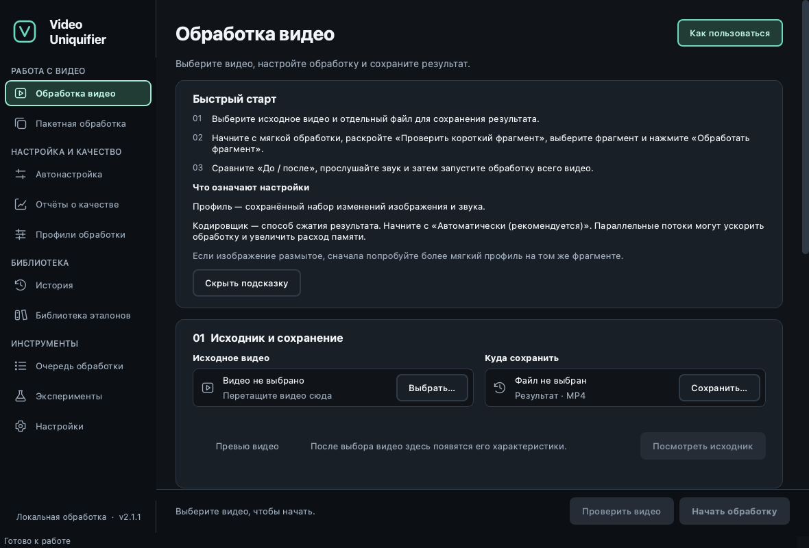
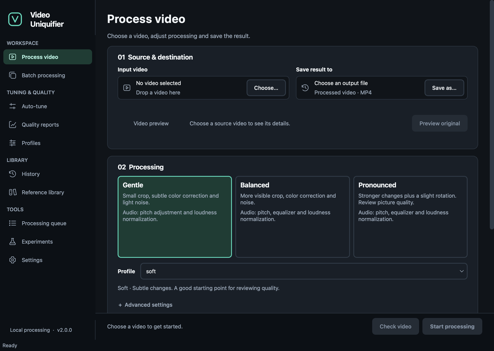
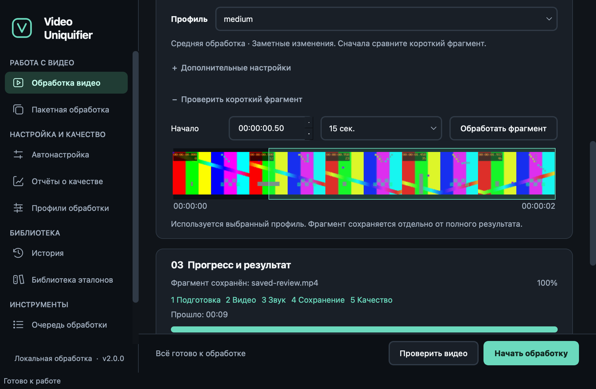
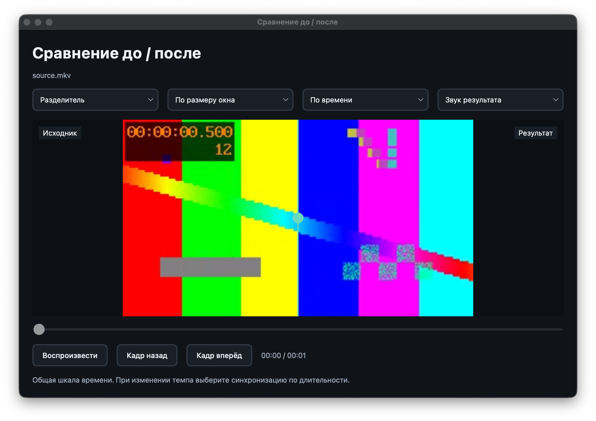
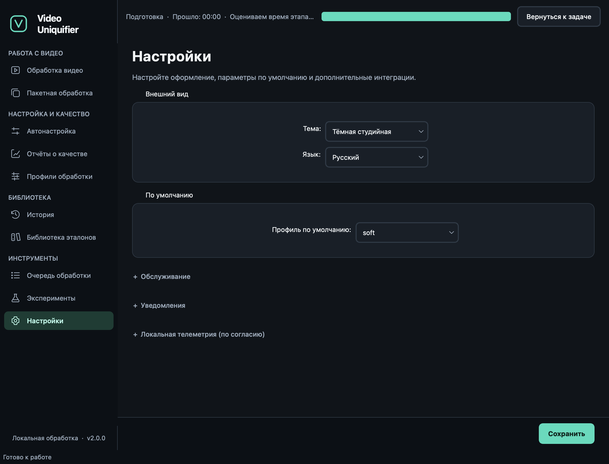
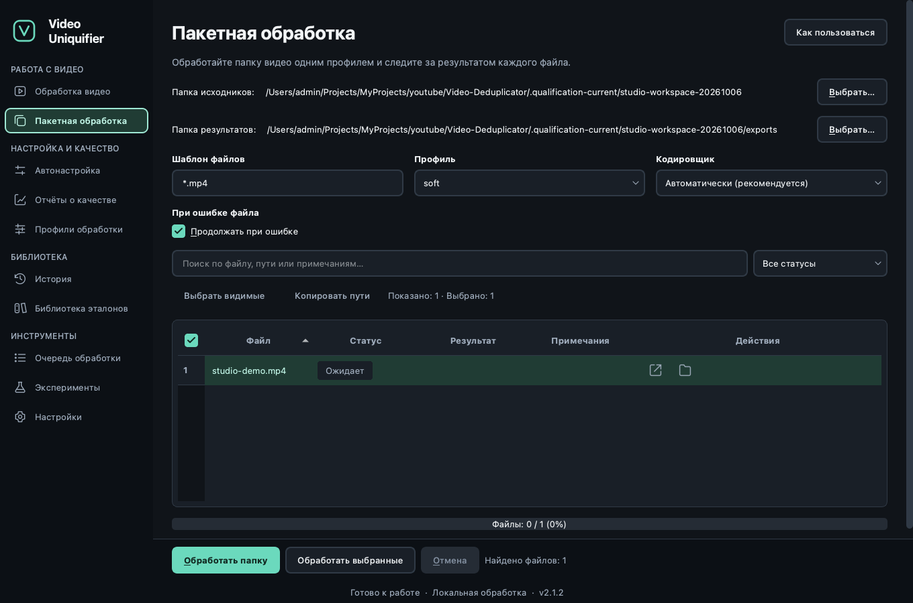
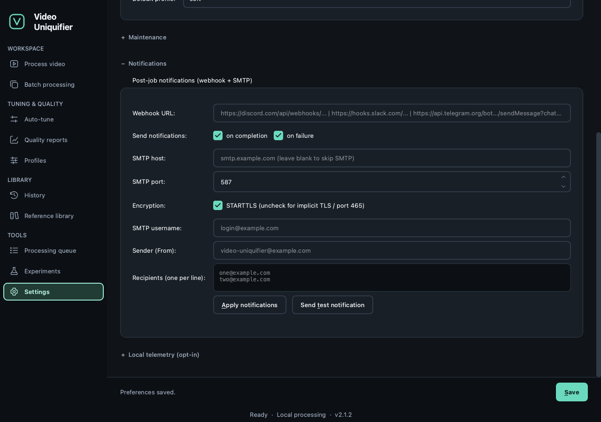
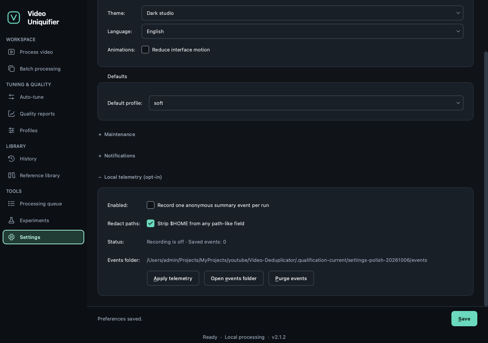

<a id="gui-guide"></a>

# 桌面界面参考

`video-uniq-gui` 是 video-uniquifier 的桌面用户界面。它与 CLI 完全一致 —— 在 `video-uniq <cmd>` 中可以做的任何操作，在这里也可以做，而且还有一些额外功能（配置文件编辑器、运行历史、嵌入式 QA 浏览器、验证向导）。

<a id="install-launch"></a>

## 安装 + 启动

```bash
pip install 'video-uniquifier[gui]'
video-uniq-gui
```

`PyQt6-WebEngine`（约 150 MB）启用嵌入式 QA 浏览器。如果缺失或以无头模式运行（例如 CI smoke），QA 浏览器将回退到标签 + "在浏览器中打开" 按钮。

<a id="screen-overview"></a>

## 屏幕概览

左侧边栏将其十个屏幕分为工作区、调优与质量、库和工具。每个页面都有标题和说明。深色工作室是新会话的默认主题；浅色主题使用相同的组件系统。可展开面板会淡入显示；**设置 → 减少界面动画**可禁用这些动画。时间码使用等宽系统字体。页面内容在小窗口中滚动，而不会将主要操作挤出屏幕。已有的偏好设置仍然有效。导航会调用每个屏幕的`on_show()`挂钩，以保持状态最新。就绪状态、本地处理说明和应用程序版本一起居中显示在底部栏。

每个页面标题中的**如何使用**会打开内联快速入门：三个步骤、该部分的关键术语以及实用提示。按**F1**即可打开或关闭当前页面的指南，即使侧边栏拥有键盘焦点也可使用。
**隐藏指南** 会关闭它并将焦点返回到标题按钮。帮助内容默认折叠，遵循所选的英语/俄语语言和主题，并保持工作控件和后台任务可用。对于你的第一个视频，请从处理视频开始，并在处理整个文件之前先查看一个简短样本。



<a id="1-process-video-run"></a>

### 1. 处理视频（运行）

单文件唯一化。

**流程视频**工作区将源视频和目标视频并排放置在顶部，左侧是一个默认暂停的大播放器，右侧是可滚动的设置检查器。处理开始后，在下方会显示全宽的进度/结果；全新会话会将该空间保留给预览。活动日志位于结果下方，其折叠的标题占用一行；展开后可读取消息，并可拖动分隔线调整高度。切换**原始 / 已处理**以检查源视频或最新完成的输出。使用播放/暂停、搜索滑块（包括键盘箭头）和**声音**。当页面隐藏或处理开始时，预览会暂停。本地编解码器错误会出现在播放器旁；它们不会禁用处理。

拖动面板分隔条以更改面板大小。使用 Tab 键聚焦分隔条，然后使用左/右或上/下键进行键盘调整。应用程序会在退出时保存面板大小，并在下次启动时恢复。在检查器底部点击 **重置工作区布局** 可恢复默认比例。固定的底部操作栏始终可见。



工作流程包含以下部分：

1. **输入视频 / 保存结果到** — 在顶部条中选择或拖放本地视频。将鼠标悬停在文件名上可查看完整路径。GUI 会在后台读取其编解码器、分辨率、帧率、时长和 HDR 标志。在大型播放器中显示源视频，并在输入旁边建议 `<source>.processed.mp4`，如果该文件已存在会加上后缀。手动选择目标位置，在源文件更改时会保留该选择。源文件和输出文件路径不能相同。
2. **处理配置文件** — 选择紧凑型的温和、中等或强效卡片。展开**此配置文件的更改内容**以查看所选配方的图片/音频细节。新的会话从 `soft` 开始；已保存的配置文件胜出。
3. **尝试短样本** — **处理样本** 保持在检查器底部，而其设置滚动。查看默认样本或展开**选择样本间隔**以更改其起始和持续时间。
   **高级和自定义配置文件** 以下包含完整的配置文件选择器、编码器选择、一个可用的 **编辑配置文件** 链接和自动调优。选择自定义配方会自动显示这些控件。
4. **进度与结果** — 当作业开始时显示；跟踪视频/音频进度和分段状态。完成的运行会显示**打开处理后的视频**和**打开质量报告**。处理完成时，结果面板会显示这些操作。**测量指标** 是一个独立的折叠块，用于诊断值。即使下一个目标更改，视频操作仍会保留已完成的路径。

固定操作栏解释缺失内容，并提供 **检查视频** 和
**开始处理** (`Ctrl+P` / `Ctrl+R`)。检查也由处理流水线强制执行。阻塞性发现会保持活动状态，直到 input/配置文件/encoder 发生更改；旧设置的结果将被丢弃。处理过程中，输入控件被禁用，**暂停**/**取消** 可用。

**设置样本起点** 在主播放器上选择当前源播放位置，并在检查器中显示样本控制。要更改样本，请展开 **选择样本间隔**，在缩略图影片条上选择起点或输入 `HH:MM:SS.cc`，选择 10、15 或 20 秒时长，然后点击 **处理样本**。影片条在可取消的后台工作进程中解码五个小帧；点击或拖动选择起点，或使用箭头键按秒移动。源较短时，选择将在末尾缩短。无损的 FFV1/PCM 参考会通过所选的配置文件和正常处理/质量控制管道进行处理。完整的目标和运行历史保持不变。**保存样本…** 将处理后的 MP4 复制到选定位置；保存的副本在应用关闭后仍可使用。保存操作可以取消，并且是原子性的。 并且无法覆盖原始源文件或临时审阅文件，包括通过符号链接或硬链接的别名。未保存的样本是临时的：创建另一个样本或关闭应用程序会将其删除。HDR 样本已禁用，因为此参考格式无法保证保留所有 HDR 元数据；完整文件处理仍然可用。



当样本完成时，**前 / 后**会自动打开。完成的完整运行会显示**比较前 / 后**。两个播放器共享播放/暂停按钮和时间线；只能听到选定的音轨。选择并排、原始或结果，或**可拖动分隔条**。分隔条在同一画布上叠加两个SDR帧：拖动其把手或使用左右、首页和尾页键。左侧显示源，右侧显示结果；裁剪/旋转差异仍然可见。已知的PQ/HLG HDR帧使用原生视频面板，而不是光栅分隔条。选择适合窗口、50%、**100%**、200%或400%（100%表示每个解码像素对应一个物理屏幕像素）。拖动放大图像以平移；分隔条为两个图像共享相同的偏移，而并排面板同步滚动比例。帧按钮会暂停并使用附近的 解码时间戳，包括可变速帧。**按时间同步**使用公共时间范围；
**按持续时间同步**也会为恒定节奏变化映射时间和播放速率。这些模式在任意编辑后不会注册匹配场景。如果本地播放器中没有可用的编解码器，其错误会显示在窗口中；现有的**打开处理后的视频**操作仍会打开系统播放器。



处理阶段包括准备、视频、音频、保存和质量检查。百分比描述的是当前阶段或观察到的音频过程，而不是整个任务的虚构百分比。经过时间不包括暂停时间。剩余时间估计适用于当前阶段，并仅在经过几次进度测量后显示；它会在新阶段、指标过程和重试时重置，并在进度停滞或无法测量时消失。

当运行、采样、保存采样、自动调谐、批处理或队列工作进程活动时，全局活动横幅会固定在页面顶部。您可以自由导航，并使用 **返回任务** 重新打开其界面。当多个工作流处于活动状态时，请在横幅中选择任务。未知进度使用不确定条显示，完成的任务会自动移除横幅。



**活动日志** 初始为折叠状态，记录错误时会自动展开。也可以使用键盘进行展开。自动编码器选择仍然可用；手动选择会传递给现有核心 API。

展开的指标使用响应式 KPI 标签，并按频段进行颜色编码：
- **pHash 最差块** — 绿色 < 0.75，黄色 < 0.85，红色 ≥ 0.85
- **VMAF 平均值** — 绿色 ≥ 85，黄色 ≥ 75，红色 < 75
- **音频 FP 汉明** — 绿色 ≥ 18 位，黄色 ≥ 10 位，红色 < 10
- **最大相似度** — 传统显示范围：绿色 < 0.2，黄色 < 0.4，红色 ≥ 0.4

这些颜色是本地诊断显示范围，而非概率、人类质量范围或预测的 Content ID 结果。缺失的测量显示为 `n/a`。

<a id="2-batch-processing"></a>

### 2. 批处理

文件目录迭代器。选择输入目录 + 输出目录 + 通配符模式（默认 `*.mp4`） + 配置文件 + 编码器。匹配的文件在表格中预览；点击 ▶ 运行批处理，各行在工作进程进展时更新其状态（待处理 → 运行中 → 完成 / 失败）。

使用 Ctrl/Cmd 或 Shift 选择多行，然后使用 **处理所选** 只运行这些可见文件。**运行批处理** 会处理匹配预览中的每个文件，包括搜索或状态筛选隐藏的行。两个命令在启动时都会捕获文件列表；之后加入文件夹的文件属于下一批处理。在运行期间，输入保持禁用，而列表搜索和选择保持可用。

“遇错继续”会在每个文件失败时继续处理批次（默认）；取消选中则在第一个失败时停止。



历史、批处理和队列文件表共享**搜索**和**所有状态**控件。搜索包括完整路径；队列项涵盖待处理、进行中、已完成和失败的分类，但不包括工作进程心跳/错误旁车文件。点击表头可排序，拖动表头边缘可调整大小，或拖动表头可重新排列列。列的大小、顺序和排序设置在退出时会保存。更新会保留所选文件的身份。

左上角表格中的复选框用于选择或清除所有可见行；破折号表示部分选择。它会选择行而不更改配置文件效果。使用**选择可见行**进行批量选择，使用**复制路径**获取所选可见文件。隐藏行会将其从选择中移除。每行提供文件和包含文件夹按钮；历史记录也可以打开其QA报告。右键点击行可执行相同的文件/文件夹操作，复制所选路径或选择可见行。状态颜色始终包含文本；完整路径可在悬停时查看。这些选择命令不会删除队列文件或历史记录。

<a id="3-auto-tune-calibrate"></a>

### 3. 自动调谐（校准）

根据目标自匹配搜索配置文件强度。选择源+基础配置文件+目标自匹配（默认0.2）+最小质量（默认
88) + 迭代次数（默认5） + 总探测秒数（默认60，分布在开始/中间/结束）。图表每次试验绘制三条系列：
`intensity_factor`, `self_match`, `quality / 100`。完成后，点击“将调优后的配置文件保存为…”以写入结果。

如果校准循环没有收敛（“⚠ 目前最佳”），保存的配置文件是所见的最低违规候选，但它未通过两个约束。在更改剪辑预算、基础配置文件或阈值之前，请检查报告的 VMAF/SSIM 后端和候选项。

<a id="4-quality-reports-qa-viewer"></a>

### 4. 质量报告（QA 查看器）

两种模式：
- **打开已有** — 选择任何 `.qa.html` 并将其嵌入渲染。
- **计算新报告** — 选择（输入, 输出）对并在内联计算报告。输出路径会写在输出文件旁边，如
  `<output>.mp4.qa.json` / `.qa.html`.

<a id="5-profiles-profile-editor"></a>

### 5. 配置文件（配置文件编辑器）

内联 YAML 配置文件编辑。从下拉菜单中选择一个配置文件；转换表会加载三列：
- 转换 ID（如果不在当前注册表中显示为红色）
- 启用复选框
- 参数以 JSON 形式（可编辑）

下面是顶级 `seed_strategy` 选择器。效果和实时 YAML 预览占用不同的标签页，保持编辑器在窄窗口中可读。“保存”会覆盖为 `.yaml.bak` 备份；“另存为…”会提示新路径。

任何参数单元格中的无效 JSON 都会阻止保存，并显示带有行号的 QMessageBox。

<a id="6-history"></a>

### 6. 历史记录

最近 100 次运行（有上限，保存到
`~/.config/video_uniquifier/history.json`）。每行有“打开输出”+“QA”按钮。筛选框可匹配源 / 配置文件 / 编码器 / 状态。“全部清除”会清空文件。

<a id="7-corpus"></a>

### 7. 语料库

对本地指纹索引进行 CRUD 操作。添加文件 → CorpusWorker 在后台索引它（长视频每个处理需要几秒钟）。通过 ID 删除选定的行。

<a id="8-queue"></a>

### 8. 队列

两个子标签页：
- **队列管理** — 选择队列根目录（必须在支持原子重命名的共享文件系统上），“在此初始化队列”会创建 pending/、in_progress/、done/、failed/ 文件夹，“添加文件…”会将文件进行硬链接复制到 pending/，实时统计横幅每 2 秒刷新一次。
- **工作进程控制** — 启动单进程 QueueWorker 排水器：lease → run_full → release_done/failed。停止是协作取消。

<a id="9-validation"></a>

### 9. 校验

v0.4.1 实际 CID 验证工具的三步向导：
- **生成** — 从一个源生成 N 个变体。调用 GenerateVariantsWorker（封装 `tools/generate_variants.py`）。
- **记录** — 可编辑表格，包含每个变体的本地诊断 KPI + `upload_date`、`youtube_video_id`、`match_status` 的空单元格。
  `notes`。“保存到 validation_log.csv”会追加内容。
- **分析** — 将 `python tools/validation_correlate.py` 对 CSV 运行并显示输出（每个预测器的 Spearman 相关系数）。

在步骤 1 和 2 之间手动上传：完整流程请参见 [docs/validation_harness.md](validation_harness.md)。

<a id="10-settings"></a>

### 10. 设置

- **主题** — 黑暗 / 亮色 / 系统（系统在 MVP 中回退为黑暗）；通过 state.theme_changed 信号实时应用。
- **默认配置文件** — 在启动时在“处理视频”和“批量处理”中预先选择。自动调谐有其自己的 base-配置文件选择器。
- **维护** — 重置编码器缓存（删除
  `~/.cache/video_uniquifier/encoders.json`），打开日志目录，打开配置目录。
- **通知** — 可选的 webhook 和 SMTP 配置。表单标签居中于其字段；事件复选框和操作按钮共享卡片背景。
- **本地遥测**——此设备上的可选择录制。**状态**显示已保存的录制选项和存储的事件数量。更改复选框后生效
  **应用遥测**。事件文件夹会单独显示；将鼠标悬停可读取完整路径。录制保持在本地，不会通过网络发送任何内容。

保存反馈显示在固定的**保存**操作旁边，因此在页面滚动时仍然可见。





<a id="keyboard-shortcuts"></a>

## 键盘快捷键

所有主要呼吁行动(CTA)和侧边栏导航均可通过键盘访问。屏幕阅读器用户可以在每个交互控件上依赖 `setAccessibleName` + `setAccessibleDescription`（回归测试：
`tests/unit/test_gui_accessibility.py`).

<a id="global-navigation"></a>

### 全局导航

|快捷键|操作|
|---|---|
|Cmd/Ctrl+1..0|切换到侧边栏条目 1..10 (v0.7.0)|
|Cmd/Ctrl+W|关闭窗口|
|Cmd/Ctrl+Q|退出|

<a id="run-screen"></a>

### 运行屏幕

|快捷键|操作|
|---|---|
|Cmd/Ctrl+R|**运行** — 开始编码 (别名: 助记符 `&Run`)|
|Esc|**取消** — 在下一个安全边界停止 (别名: 助记符 `&Cancel`)|
|空格键|**暂停 / 恢复** — 暂停正在运行的 ffmpeg 子进程并冻结段进度；长时间暂停 (>24 小时) 自动取消 (v0.7.0 R6 / F5)|
|Cmd/Ctrl+T|**自动调节** — 将所选配置文件校准至此输入，保存为 `<profile>.tuned.yaml`，并切换到它 (v0.7.0 R4 / F7)|
|Cmd/Ctrl+Q|**打开 QA 报告** — 打开最近一次运行生成的 HTML 报告|
|Cmd/Ctrl+P|**预检** — 针对当前源重新运行预检|

<a id="settings-screen"></a>

### 设置屏幕

|快捷键|操作|
|---|---|
|Cmd/Ctrl+,|**打开设置**|

<a id="notifications-settings-post-job-notifications"></a>

### 通知（设置 → 任务后通知）

设置屏幕在每个通知通道（v0.7.0 R5 / F4）提供一个 **测试** 按钮，它会合成一个 `completed` 事件并通过 `core.notifications.dispatch` 发送——方便在不运行完整编码的情况下验证 webhook URL + SMTP 凭证。

<a id="where-data-lives"></a>

## 数据存放位置

通过 `QStandardPaths.AppConfigLocation` + `CacheLocation` 解析（v0.7.0 R1 / E3），因此路径遵循每个操作系统的惯例。首次启动时，迁移助手会复制之前的应用设置/历史记录，并保留原件。

|路径（典型）|操作系统惯例|什么|
|---|---|---|
| `<CONFIG_DIR>/state.json`            |macOS `~/Library/Preferences/video-uniquifier`，Linux `~/.config/video-uniquifier`，Windows `%APPDATA%\video-uniquifier`|主题、最近、默认配置文件/编码器、通知配置|
| `<CONFIG_DIR>/history.json`          |与上述相同|运行历史 (≤100 条记录)|
| `<CONFIG_DIR>/crash.log`             |与上述相同|全局异常钩子跟踪日志（100 KiB 轮转，v0.7.0 R2 / E6）|
| `<CACHE_DIR>/encoders.json`          |macOS `~/Library/Caches/video-uniquifier`，Linux `~/.cache/video-uniquifier`，Windows `%LOCALAPPDATA%\video-uniquifier\Cache`|编码器检测缓存（可从设置重置）|
| `<CACHE_DIR>/work/<plan_hash>/`      |与上述相同|运行 work_dir（分段、state.json、恢复标记）|
| `<CACHE_DIR>/keyframes/`             |与上述相同|关键帧扫描缓存（30 天 TTL）|
| `<CACHE_DIR>/corpus/index.json`      |与上述相同|语料指纹索引|
| `<CACHE_DIR>/batch/<plan_hash>/`     |与上述相同|批次工作进程临时数据|
| `<CACHE_DIR>/worker/<plan_hash>/`    |与上述相同|队列工作进程临时数据|

<a id="packaging"></a>

## 打包

已附带启动器 `pyinstaller/video-uniq-gui.spec`。在 macOS 上：

```bash
pip install pyinstaller
pyinstaller pyinstaller/video-uniq-gui.spec --clean --noconfirm
open dist/video-uniq-gui.app    # unsigned: right-click → Open first time
```

在 Windows / Linux 上，PyInstaller 也可以生成单文件发行版。如果 PyInstaller 在你的平台上失败，备选方案始终是 `pipx install 'video-uniquifier[gui]'`，可在任何地方使用。

<a id="troubleshooting"></a>

## 故障排除

**问：PyQt6无法在我的Linux上安装。** 答：某些发行版需要先安装`apt install libxcb-cursor0 libgl1`，PyQt6的二进制安装包才能正常工作。

**问：QA查看器显示的是标签而不是嵌入的报告。** 答：要么是`PyQt6-WebEngine`未安装（`pip install 'video-uniquifier[gui]'`），要么你在无头模式下运行（离屏Qt会强制使用标签回退，因为嵌入的浏览器在那里会崩溃）。

**问：编码器看起来不对 / 不可用。** 答：设置 → 重置编码器缓存。下一次启动会重新探测。
